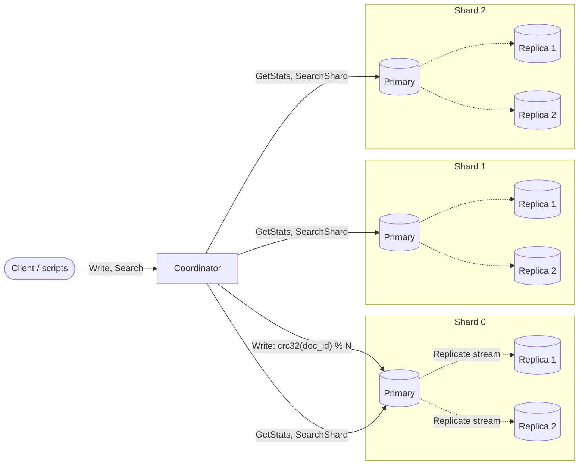
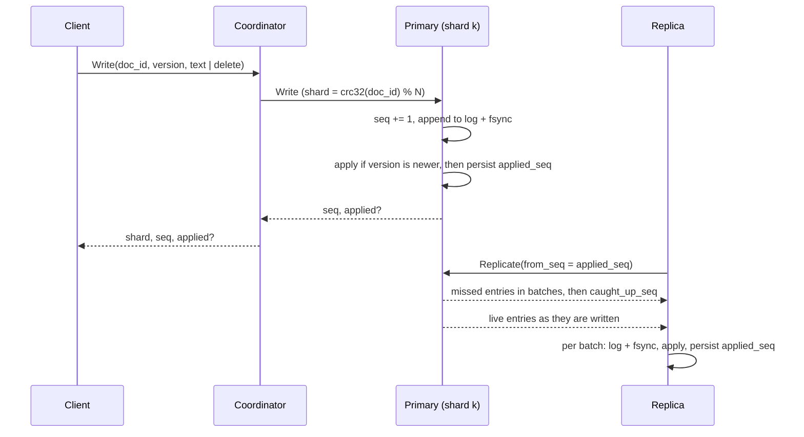
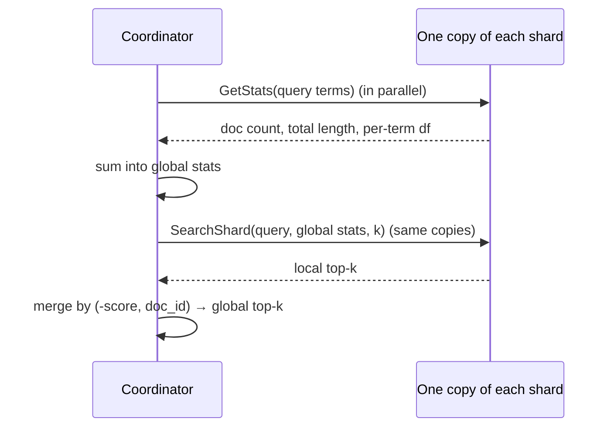
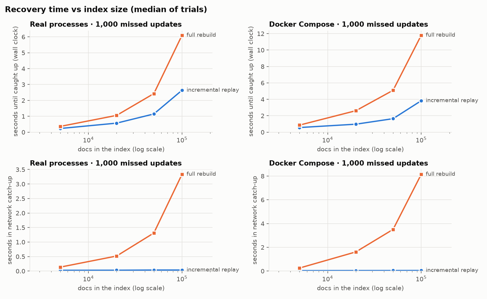
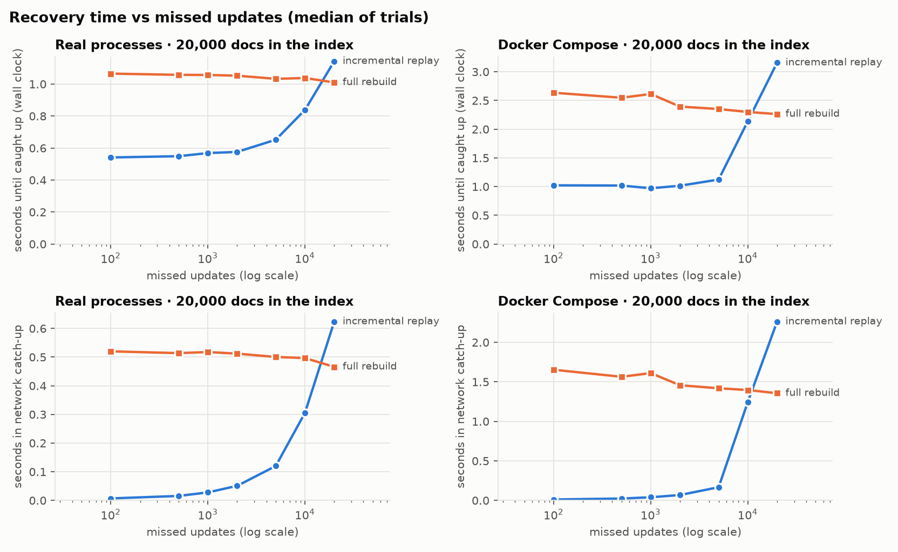
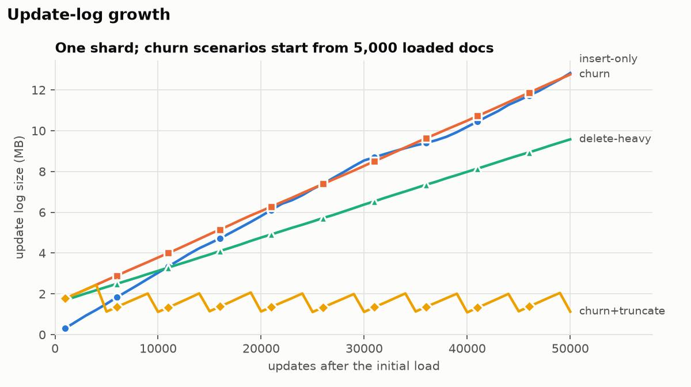
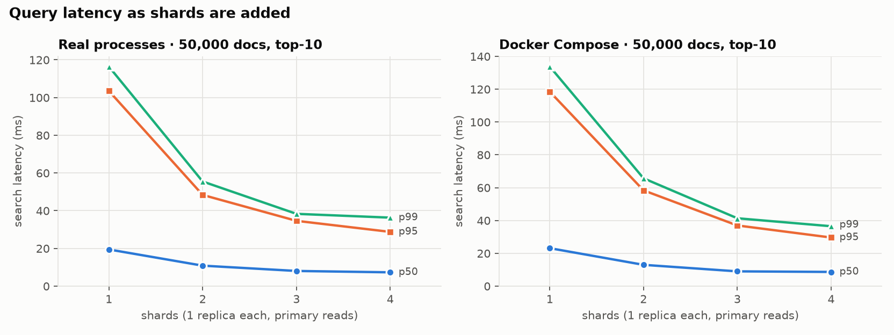

# Distributed Search Engine with Incremental Index Recovery

A small distributed search engine modelled on Elasticsearch. Documents are hash-partitioned across shards. Each shard
keeps its own inverted index and has a primary and replicas. A coordinator answers queries by scatter-gather and ranks
with BM25 using cluster-wide statistics. When a replica comes back after a crash or a network partition, it replays
only the updates it missed from the primary's update log instead of rebuilding its whole index.

IITH Distributed Systems course project, by Aviral Tyagi and Harsh Jaiswal. The evaluation report is in
[eval/REPORT.md](eval/REPORT.md).

## Results at a glance

- **Convergence:** a replica is partitioned and another crashed while replaces and deletes continue. After they
  recover, every copy matches a single-node reference with **zero differences** in documents, versions, tombstones
  and query results (order and exact scores).
- **Recovery is incremental:** with 1,000 missed updates, network catch-up takes 0.03–0.05 s whether the index holds 5k or
  100k documents. A full rebuild of a 100k-doc shard takes 3.3 s (real processes) to 8.2 s (Docker): 95–170× slower.
- **Correct merged search:** for every shard count from 1 to 4, the merged top-10 equals the single-node reference in
  order and score. Median latency falls from 19.5 ms (1 shard) to 7.3 ms (4 shards).
- **Bounded log:** without truncation the update log grows by 175–257 bytes per update; with truncation after
  snapshots it stays between 1.1 and 2.0 MB.

## Architecture



Every node is a separate process (a container under Docker Compose) and every call is gRPC. The protocol is defined in
[proto/dsearch/proto/search.proto](proto/dsearch/proto/search.proto).

| Component | Code | Role |
|---|---|---|
| Coordinator | [coordinator/](src/dsearch/coordinator/) | Routes each write to its shard's primary. Runs two-phase scatter-gather search and merges the shards' top-k. |
| Shard primary | [shard/primary.py](src/dsearch/shard/primary.py) | Gives each update the next sequence number, logs and applies it, then acknowledges. Serves replication and snapshots. |
| Replica | [shard/replica.py](src/dsearch/shard/replica.py) | Pulls from the primary, applies strictly in sequence order, recovers incrementally after a disconnect. |
| Node storage | [shard/store.py](src/dsearch/shard/store.py), [storage/](src/dsearch/storage/) | On every copy: an append-only update log, SQLite holding the applied seq and the latest snapshot, and the in-memory index. |
| Index and ranking | [index/](src/dsearch/index/) | Inverted index with per-document versions and tombstones; BM25 over global statistics. |
| Reference | [reference/single_node.py](src/dsearch/reference/single_node.py) | The same index code in one process, fed the same operations. The oracle for every correctness check. |
| Convergence checker | [convergence.py](src/dsearch/convergence.py) | Compares every copy of a running cluster, and the cluster's search results, with the reference. |

### Writes and replication



- **Versions and tombstones.** Every write carries a per-document version. It is applied only if newer than the stored
  version, including a tombstone's, so stale, duplicated and reordered requests are no-ops. A delete keeps a
  tombstone `(doc_id, version)` that is logged, replicated and replayed like any other update. A late, older insert
  therefore can't bring a deleted document back. A replace removes the old postings and adds the new ones with no
  search in between.
- **Durability order.** Log and fsync, then apply to the index, then persist the applied seq. The applied seq is never
  ahead of the index. Replaying an entry twice leaves the same state.
- **Asynchronous replication.** The primary acknowledges once its own copy is durable. Each replica keeps one stream
  open to its primary: catch-up from its applied seq, a `caught_up_seq` marker, then live entries. Any gap or
  out-of-order seq drops the stream, and the replica reconnects from its applied seq.

### Recovery

- **Restart:** a copy loads its snapshot and replays its own log after it. It then asks the primary only for entries
  after its applied seq, which is exactly what it missed while down.
- **Partition:** HTTP/2 keepalive pings break a silent connection within seconds. The replica keeps retrying and
  catches up incrementally once the network heals.
- **Full rebuild, only when unavoidable:** with log truncation enabled, the primary keeps a fixed number of entries
  behind each snapshot. If a replica needs entries that were truncated, it fetches the primary's state at one seq,
  installs it crash-safely, and continues incrementally from there. Every full rebuild is logged at WARNING and
  counted in the node's status.

### Search



Scoring every shard with the same global document count, document frequencies and average length makes scores
comparable, so the merged top-k equals the single-node result exactly. Equal scores are ordered by `doc_id`. Searches
read primaries by default (`round_robin` spreads them over replicas). If a copy is unreachable another copy of that
shard is used; if a shard has no reachable copy, the query fails rather than returning partial results.

## Running it

Requirements: Python 3.11+ (the Makefile uses 3.12), and Docker with Compose for the cluster. Developed on macOS with
colima (4 CPUs, 6 GB).

```sh
make venv        # .venv with the dev, eval and data extras (editable install)
make proto       # generate gRPC stubs into src/dsearch/proto/ (also done by make test)
make corpus      # data/corpus.jsonl: 100k Simple English Wikipedia lead paragraphs (about 150 MB download)
```

### Docker Compose cluster

One coordinator (on host port 50050) and 3 shards × (1 primary + 2 replicas), each node with its own volume. The
topology is [config/docker.toml](config/docker.toml).

```sh
make cluster-up                # docker compose up -d --build

docker compose run --rm tools python scripts/load_data.py --limit 20000
docker compose run --rm tools python scripts/run_workload.py --count 10000 --rate 300 &
python scripts/inject_fault.py disconnect shard0-replica1   # partition a replica
python scripts/inject_fault.py kill shard1-replica2         # crash another
sleep 15                                                    # churn continues without them
python scripts/inject_fault.py connect shard0-replica1
python scripts/inject_fault.py start shard1-replica2
wait

docker compose run --rm tools python scripts/cluster_status.py --wait-replicas 60
docker compose run --rm tools python scripts/check_convergence.py --ops data/run/ops.jsonl
python scripts/run_queries.py "solar system" --k 5           # coordinator on localhost:50050
make cluster-down              # stop and delete all node data
```

`python scripts/fault_scenario.py --fresh` runs that whole scenario and ends with the convergence check.

| Script | What it does |
|---|---|
| `prepare_corpus.py` | Downloads Simple English Wikipedia and writes the abstracts corpus. |
| `load_data.py` | Inserts the corpus through the coordinator and starts the ops file (every operation sent, for the reference). |
| `run_workload.py` | Seeded churn: replaces, deletes, re-inserts, plus stale and duplicate re-sends. Appends to the ops file. |
| `inject_fault.py` | `kill`, `start`, `disconnect`, `connect`, `freeze`, `unfreeze` a Compose service. |
| `cluster_status.py` | Every copy's applied and logged seq, log size, recovery sessions and full rebuilds. |
| `check_convergence.py` | Rebuilds the reference from the ops file and compares every copy and the search results with it. Exit 0 means zero differences. |
| `run_queries.py` | Runs queries through the coordinator and prints hits and latency. |
| `fault_scenario.py` | The full partition-and-crash scenario above, ending with the convergence check. |

Scripts take `--coordinator host:port` or `--config cluster.toml`. Run them inside the Compose network with
`docker compose run --rm tools ...`; the coordinator is also published on `localhost:50050`.

### Without Docker

- `python -m dsearch.coordinator` and `python -m dsearch.shard` run one node each, configured as below.
- [dsearch.process_cluster.ProcessCluster](src/dsearch/process_cluster.py) starts a whole cluster as local OS
  processes, with real `SIGKILL` crashes. The evaluation and the process tests use it.
- [dsearch.local_cluster.LocalCluster](src/dsearch/local_cluster.py) runs a whole cluster inside one Python process
  on localhost ports. Most integration tests use it.

### Configuration

Each node reads an optional TOML file at `$DSEARCH_CONFIG`, holding the shared topology (see
[config/cluster.example.toml](config/cluster.example.toml)). `DSEARCH_*` environment variables override it.

| Variable | Default | Meaning |
|---|---|---|
| `DSEARCH_NODE_ID`, `DSEARCH_ROLE`, `DSEARCH_SHARD_ID` | `node-0`, `coordinator`, none | Node identity; role is `coordinator`, `primary` or `replica` |
| `DSEARCH_HOST`, `DSEARCH_PORT` | `127.0.0.1`, `50051` | Listen address |
| `DSEARCH_NUM_SHARDS`, `DSEARCH_REPLICAS_PER_SHARD` | `3`, `2` | Must match the `[[shards]]` topology |
| `DSEARCH_DATA_DIR` | `data` | The node stores its log and SQLite state in `<data_dir>/<node_id>/` |
| `DSEARCH_SNAPSHOT_EVERY` | `10000` | Applied entries between snapshots (0 = off) |
| `DSEARCH_LOG_RETENTION` | `0` | Log entries kept behind each snapshot (0 = never truncate) |
| `DSEARCH_SEARCH_PREFERENCE` | `primary` | `primary` or `round_robin` over a shard's copies |
| `DSEARCH_RPC_TIMEOUT` | `5.0` | Seconds per coordinator-to-shard call |
| `DSEARCH_KEEPALIVE_TIME`, `DSEARCH_KEEPALIVE_TIMEOUT` | `5.0`, `5.0` | HTTP/2 ping interval and ack timeout (partition detection) |
| `DSEARCH_LOG_LEVEL` | `INFO` | Python log level |
| `DSEARCH_FORCE_FULL_REBUILD` | `0` | Replica does a full rebuild on first connect. Evaluation baseline only |

## Tests

```sh
make test          # 157 tests, no Docker needed (about 20 s)
make test-docker   # the partition-and-crash scenario on the Docker Compose cluster
```

| What is checked | Where |
|---|---|
| Versions, stale/duplicate/reordered writes, tombstones blocking re-inserts | [tests/unit/test_index_versions.py](tests/unit/test_index_versions.py), [tests/property/test_index_properties.py](tests/property/test_index_properties.py) |
| Replace is atomic for search, including a replicated batch | [tests/unit/test_replace_atomic.py](tests/unit/test_replace_atomic.py) |
| BM25, tokenizer, routing | [tests/unit/](tests/unit/) |
| Durability order, crash between steps, idempotent replay, torn log tails | [tests/unit/test_durability_order.py](tests/unit/test_durability_order.py), [test_log_replay.py](tests/unit/test_log_replay.py), [test_update_log.py](tests/unit/test_update_log.py), [test_batch_writes.py](tests/unit/test_batch_writes.py), [tests/property/test_store_recovery.py](tests/property/test_store_recovery.py) |
| Replication and exact catch-up counts (only the missed range is replayed) | [tests/integration/test_replication.py](tests/integration/test_replication.py), [tests/unit/test_primary_catchup.py](tests/unit/test_primary_catchup.py) |
| Global-stats search matches the reference in order and score | [tests/integration/test_scatter_gather.py](tests/integration/test_scatter_gather.py), [tests/property/test_cluster_search.py](tests/property/test_cluster_search.py) |
| **Convergence after a disconnect during replaces and deletes** | [tests/integration/test_convergence.py](tests/integration/test_convergence.py), [tests/property/test_convergence.py](tests/property/test_convergence.py), [tests/property/test_replication_convergence.py](tests/property/test_replication_convergence.py) |
| Silent network partition (black-holing TCP proxy) | [tests/integration/test_partition.py](tests/integration/test_partition.py) |
| Real `SIGKILL` crashes of separate processes | [tests/integration/test_process_cluster.py](tests/integration/test_process_cluster.py) |
| Log truncation and full rebuild | [tests/unit/test_store_truncation.py](tests/unit/test_store_truncation.py), [tests/integration/test_full_rebuild.py](tests/integration/test_full_rebuild.py) |
| Docker Compose partition-and-crash scenario | [tests/docker/test_cluster_convergence.py](tests/docker/test_cluster_convergence.py) |

The Hypothesis tests generate random insert, replace and delete sequences, including duplicates and reorderings, and
disconnect a replica at a random point. Every one is checked against the single-node reference.

## Evaluation

Recovery time (incremental replay vs full rebuild), update-log growth, and query latency as shards are added, each
measured on real processes and on Docker. Full results, method and limitations: [eval/REPORT.md](eval/REPORT.md).

| | |
|---|---|
|  |  |
|  |  |

To reproduce (about 25 minutes):

```sh
make corpus && docker compose build
python eval/recovery_time.py --backend process && python eval/recovery_time.py --backend docker
python eval/query_latency.py --backend process && python eval/query_latency.py --backend docker
python eval/log_growth.py
python eval/plot.py            # eval/plots/*.png and eval/results/summary.md
```

## Scope and limitations

- **No primary failover.** There is no leader election. While a shard's primary is down, writes to that shard fail with
  `UNAVAILABLE`, and searches use its replicas. Writes resume when the primary restarts from its own log.
- **Replication is asynchronous.** A write is acknowledged once the primary's copy is durable. A search on a replica can
  briefly miss the newest writes until it catches up.
- **Versions come from the client** (like Elasticsearch's external versioning), and the index is held in memory on
  every copy.
- All experiments ran on one laptop; see the limitations in [eval/REPORT.md](eval/REPORT.md).

## Repository layout

```
proto/dsearch/proto/search.proto   gRPC services and messages (the source of truth)
src/dsearch/
  coordinator/                     routing, scatter-gather search, coordinator server
  shard/                           primary, replica, node storage, shard server
  storage/                         update log, log entry encoding, SQLite state
  index/                           tokenizer, inverted index, BM25, operations
  reference/                       single-node reference
  convergence.py                   convergence checker
  workload.py, ops_file.py         workload driver and the record of sent operations
  local_cluster.py, process_cluster.py   whole clusters for tests and evaluation
scripts/                           cluster, data, fault-injection and checking scripts
eval/                              evaluation scripts, plots, results/summary.md, REPORT.md
tests/                             unit/, property/, integration/, docker/
config/                            cluster topologies (example, Docker)
Dockerfile, docker-compose.yml, Makefile
```
