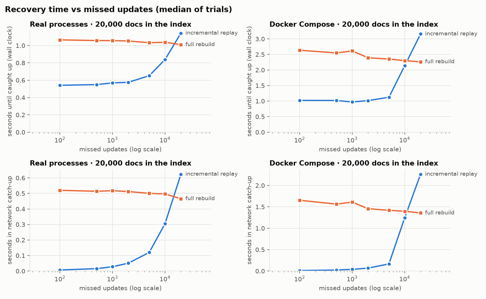
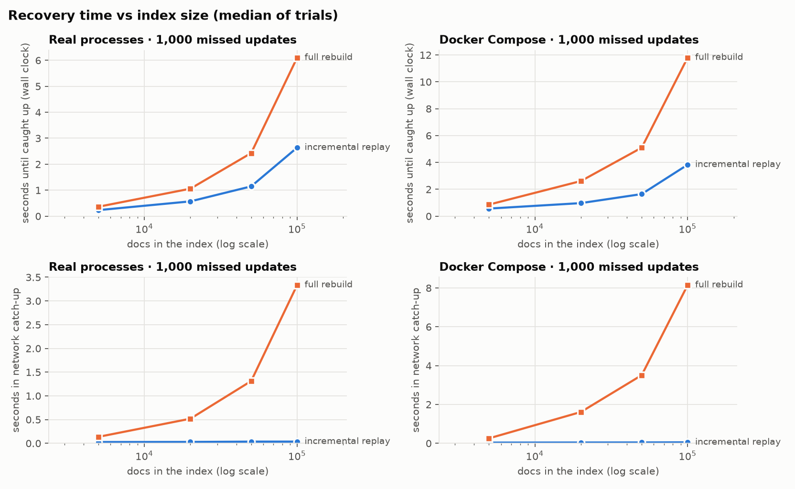
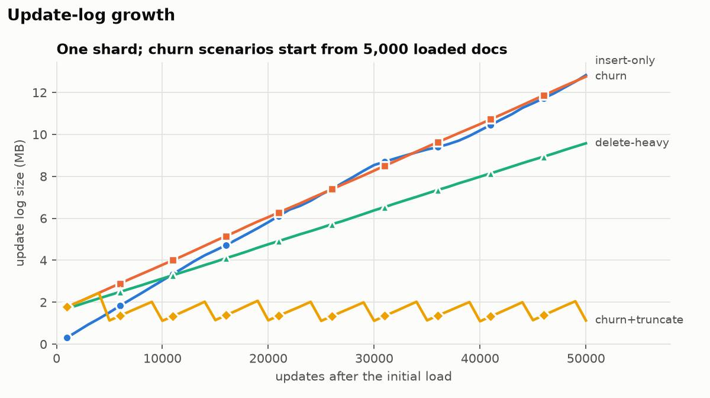
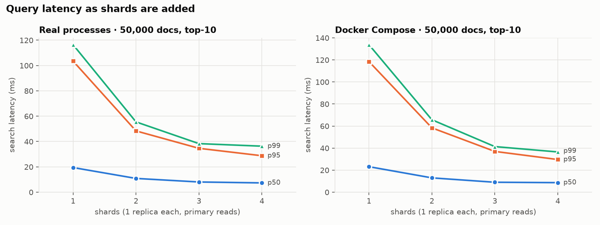

# Evaluation report

This report covers recovery time (incremental log replay vs. full rebuild), update-log growth, and query latency as
shards are added. All numbers come from `eval/results/summary.md`, which `eval/plot.py` generates from the measurements.

## Setup

- **Machine:** Apple M1 Pro (8 cores, 16 GB), macOS 27.
- **Backends:** every experiment except log growth ran twice.
  - Once as **real processes**: one OS process per node on localhost.
  - Once on **Docker Compose** under colima, a VM with 4 CPUs and 6 GB, with data on virtiofs bind mounts.
  - Both runs use the same entry points and the same harness (`eval/harness.py`).
- **Corpus:** 100,000 Simple English Wikipedia lead paragraphs (median 35 words).
- **Churn:** the workload driver's seeded mix: 55% replace, 20% delete, 10% re-insert, 10% stale re-send, 5% duplicate.
- **Correctness of every measurement:** each recovered replica was compared with its primary through `DumpState` and
  was identical. Each incremental run replayed exactly the missed number of entries. Each forced run did exactly one
  full rebuild.
- **Timing definitions:**
  - *wall clock*: from issuing the node start until the replica reports `live` with the primary's `applied_seq`,
    polled every 20 ms. It includes process or container start-up.
  - *open*: the replica loading its own local snapshot and replaying its local log.
  - *network catch-up*: the recovery session. For incremental recovery that is replaying the missed log entries. For a
    full rebuild it is fetching the snapshot, installing it, and replaying the short tail.
- **Repetitions:** 3 trials per point; medians are reported. Incremental and full runs alternated which went first.

## 1. Recovery time




**Incremental recovery cost scales with the number of missed updates, and a full rebuild scales with the index size.**

- **Fixed missed updates (M = 1,000), index grows from 5k to 100k docs:**
  - Incremental catch-up stays flat: 0.026–0.035 s for processes, 0.034–0.048 s on Docker.
  - Full-rebuild catch-up grows with the index: 0.14 → 3.34 s for processes, 0.25 → 8.15 s on Docker.
  - At 100k docs, incremental catch-up is **95× faster** (processes) and **170× faster** (Docker).
- **Fixed index (20k docs), missed updates grow from 100 to 20,000:**
  - Incremental catch-up grows linearly. It sustains about 32k entries/s for processes and about 9k entries/s on
    Docker, where fsync is slower.
  - Full rebuild stays flat at about 0.5 s (processes) and about 1.4 s (Docker).
  - Measured by wall clock, incremental recovery still wins at 10,000 missed updates (half the index): 0.84 s vs
    1.04 s for processes, 2.14 s vs 2.30 s on Docker. It loses at 20,000 (as many as the index holds): 1.14 s vs
    1.01 s, and 3.16 s vs 2.26 s. So the crossover lies **between 50% and 100% of the index size** on both backends.
    Only those two points were measured, so the exact crossover isn't known. Past it, a full copy is the cheaper way to
    get the state, as expected.

**Wall clock vs. network catch-up.** Both recovery modes first load the replica's own local state (open), because a
restarting replica only learns that its range was truncated after it connects. That load grows with index size: 0.11
→ 2.5 s for processes. It is the larger part of incremental recovery's wall-clock time on big indexes. So the
wall-clock advantage at 100k docs is 2.3× (processes, 2.64 s vs 6.10 s) and 3.1× (Docker, 3.83 s vs 11.81 s). The
network part of recovery, which is what the protocol controls, is where the 95–170× difference shows up.

**A design change found by this evaluation.** The first measurements showed incremental replay at only
1.3–2.9k entries/s. The replica wrote every replicated entry with two fsyncs: the log append and the SQLite
`applied_seq` update. That made a full rebuild faster once more than about 10% of the index was missed. The replica
now group-commits each replication batch: one log fsync, apply the batch, then persist the last seq once. The
durability order holds per batch. This made catch-up roughly 10× faster, and all curves above use it. The batched path
has its own crash and ordering tests (`tests/unit/test_batch_writes.py`). The Docker partition-and-crash scenario
still converges with zero differences.

## 2. Update-log growth



| scenario (50,000 updates) | log size | bytes per entry |
|---|---|---|
| insert-only | 12.8 MB | 257 |
| churn (replace-heavy) | 12.8 MB | 232 |
| delete-heavy | 9.6 MB | 174 |
| churn + truncation (snapshot every 5,000, keep 5,000) | 1.1 MB | 225 |

- **Without truncation the log grows linearly**, at about the size of the document text per update. Deletes carry no
  text, so delete-heavy streams grow more slowly. Nothing bounds this growth.
- **With truncation the log is bounded.** After each snapshot it drops entries more than `log_retention`
  behind it, so its size saw-tooths between about 1.1 and 2.0 MB (5,000 to 10,000 entries) whatever the update count.
- The price of truncation: a replica that misses more than about `log_retention` updates can no longer recover
  incrementally and gets a full rebuild. That path is covered by `tests/integration/test_full_rebuild.py`.
- The two churn scenarios end with few live docs (175 of 5,000). The churn mix deletes more often than it re-inserts,
  so long runs drain the index. This doesn't affect the log size, which depends on the entries written, but the
  recovery runs keep churn at most equal to the index size for this reason.

## 3. Query latency as shards are added



| shards | p50 (processes) | p99 (processes) | p50 (Docker) | p99 (Docker) |
|---|---|---|---|---|
| 1 | 19.5 ms | 116.5 ms | 23.1 ms | 133.8 ms |
| 2 | 10.9 ms | 55.5 ms | 13.0 ms | 65.7 ms |
| 3 | 8.1 ms | 38.3 ms | 9.0 ms | 41.4 ms |
| 4 | 7.3 ms | 36.3 ms | 8.7 ms | 36.5 ms |

Setup: 50,000 docs, 200 queries of 1–3 terms from the corpus vocabulary, 5 sequential repetitions, top-10, reads from
primaries.

- **Latency falls as shards are added.** Each shard scores only its part of the postings, and the shards score in
  parallel in separate processes. The median drops 2.7× from 1 to 4 shards, and p99 drops about 3.2×. The tail is set
  by queries with frequent terms, and splitting those helps most.
- **Returns diminish from 3 to 4 shards.** Every query pays the fixed two-phase scatter-gather cost: two RPC rounds plus
  merging. The shards also share 8 host cores, or 4 VM cores on Docker.
- **Results are identical for 1 to 4 shards.** For every query and every shard count, the merged top-10 matched the
  single-node reference in order and in exact score. That is the global-statistics property (invariants 6 and 7),
  checked here at evaluation scale.

## Limitations

- Everything runs on one laptop, so "more shards" also means more processes competing for the same cores and disk.
- macOS `fsync` doesn't force a full flush to the drive (`F_FULLFSYNC` isn't used), so host-process write and replay
  rates are optimistic compared with a Linux server. Docker on colima pays virtiofs costs instead, which is why every
  Docker durability number is 2–4× slower.
- The full-rebuild baseline is forced with `force_full_rebuild`. Its cost is the same as a rebuild caused by
  truncation, since both run the same code; this is tested.
- Wall-clock times include about 0.1 s of process start-up and about 0.4 s of container start-up, the same for both
  recovery modes.

## Reproducing

```sh
make corpus                                    # download and prepare the corpus
docker compose build                           # image for the Docker backend
python eval/recovery_time.py --backend process && python eval/recovery_time.py --backend docker
python eval/query_latency.py --backend process && python eval/query_latency.py --backend docker
python eval/log_growth.py
python eval/plot.py                            # plots/ and results/summary.md
```

The full run took about 25 minutes on the machine above.
